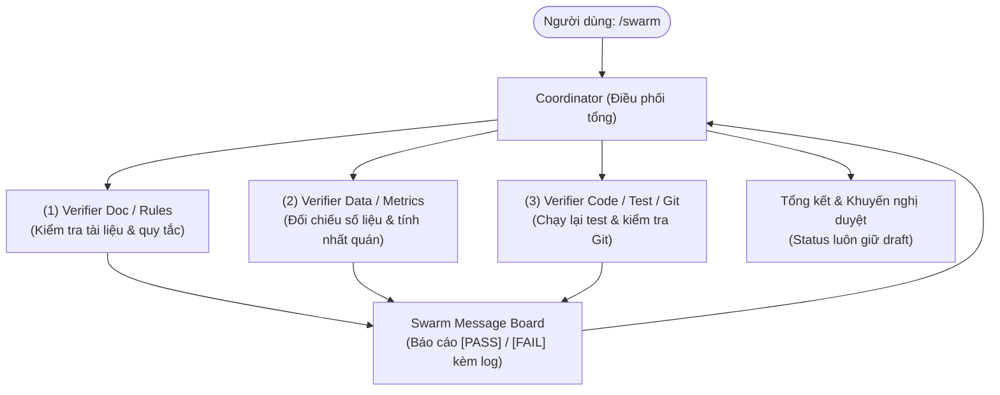

# Quy trình Swarm Self-Review liên tục

Tài liệu này đặc tả quy trình vận hành, phân bổ vai trò và các tiêu chuẩn an toàn cho mô hình **Swarm Self-Review liên tục** trong dự án DrugTime. Quy trình này kết hợp năng lực kiểm thử và phản biện đa tác nhân song song nhằm đảm bảo chất lượng kỹ thuật, tính chính xác của dữ liệu và tuân thủ tuyệt đối quy trình trước khi mở PR hoặc bàn giao sản phẩm.

---

## 1. Lệnh kích hoạt từ người dùng

Quy trình Swarm Self-Review được khởi tạo trực tiếp từ yêu cầu của người dùng thông qua các lệnh chuẩn:

- `/swarm <chỉ đạo kiểm tra>`:
  Kích hoạt Swarm thực hiện một lượt rà soát độc lập, toàn diện theo chỉ đạo hoặc tiêu chí cụ thể của người dùng (ví dụ: kiểm tra mock mode, đối chiếu số liệu độ chính xác OCR, xác minh commit git).
- `/swarm self-review tiếp cho tôi`:
  Yêu cầu Swarm tiếp tục chu trình tự rà soát, kiểm chứng chéo và hoàn thiện checklist cho giai đoạn hiện tại hoặc chuyển tiếp sang giai đoạn kế tiếp theo quy trình chung.

Khi nhận lệnh, Agent Coordinator tiếp nhận ngữ cảnh, thiết lập mục tiêu kiểm tra và phân công nhiệm vụ chuyên biệt cho 3 nhóm verifier độc lập.

---

## 2. Phân bổ vai trò trong Swarm (Coordinator + 3 Verifier)

Mô hình vận hành gồm 1 Coordinator và 3 nhóm Verifier chuyên trách hoạt động song song:



### 2.1. Coordinator (Điều phối tổng)
- Tiếp nhận lệnh từ người dùng, xác định task ID và giai đoạn hiện tại (Stage 1 đến Stage 6).
- Soạn brief rõ ràng, giao việc cho từng verifier qua bảng tin Swarm (@mention).
- Giám sát tiến độ, tổng hợp các phát hiện, ra kết luận chung [PASS]/[FAIL] và chuẩn bị nội dung bàn giao.
- Đảm bảo tính minh bạch: báo cáo rõ ràng các mặt đạt được, các giới hạn còn tồn đọng và hướng dẫn lệnh duyệt cho người dùng.

### 2.2. Nhóm 1: Verifier Doc / Rules (`verifier-doc` / `reviewer-doc`)
Chịu trách nhiệm kiểm soát chất lượng văn bản, sự tuân thủ quy chuẩn và quy tắc dự án:
- **Cấu trúc artifact**: Kiểm tra việc tuân thủ template chuẩn (`01-requirement.md` đến `06-review.md`), đầy đủ các mục quy định.
- **Tính minh bạch và giới hạn**: Xác minh các cảnh báo kỹ thuật (ví dụ: chế độ MOCK hay REAL, môi trường in-memory, các điều kiện chưa kiểm thử được ngoài thực tế).
- **Trạng thái phê duyệt**: Xác nhận trạng thái artifact là `status: draft`, tuyệt đối không có metadata duyệt tự động.
- **Dẫn chứng và liên kết**: Kiểm tra sự tồn tại và tính hợp lệ của các đường dẫn file evidence logs và mã nguồn tham chiếu.
- **Chuẩn ký tự**: Quét byte-level xác nhận 0 curly quotes (chỉ dùng straight quotes `"`).

### 2.3. Nhóm 2: Verifier Data / Metrics (`verifier-data` / `reviewer-data`)
Chịu trách nhiệm về tính toàn vẹn và độ chính xác của mọi số liệu định lượng:
- **Đối chiếu số liệu thô**: So khớp từng con số, tỉ lệ %, độ trễ (latency p50/p95), ma trận phân loại với raw evidence log trong thư mục `evidence/`.
- **Tính nhất quán chéo (Cross-Artifact Consistency)**:
  - Kiểm tra tính đồng nhất của số lượng mẫu (sample size N), phân nhóm test (Groups A1..A4), danh sách thuốc và nhãn annotations xuyên suốt từ Requirement (01) đến Review (06).
  - Không để xảy ra mâu thuẫn số liệu giữa các tài liệu qua từng giai đoạn.
- **Xác thực an toàn dữ liệu**: Đảm bảo các chỉ số an toàn (ví dụ: fallback rate 100%, 0 False Positive, không có trường hợp auto-select sai) đạt tiêu chuẩn dự án (PB31, QD-39).

### 2.4. Nhóm 3: Verifier Code / Test / Git (`verifier-code` / `reviewer-code`)
Chịu trách nhiệm về độ tin cậy của mã nguồn, kiểm thử thực tế và phiên bản Git:
- **Tái thực thi kiểm thử độc lập**:
  - Tự chạy lại các kịch bản thực thi và bộ unit test/integration test trong môi trường thực tế.
  - Xác nhận 0 failure, exit code 0 và ghi nhận thời gian thực thi.
- **Kiểm tra trạng thái Git**:
  - Xác minh nhánh làm việc (`test/<task-id>`, `feat/<task-id>`), trạng thái working tree sạch sẽ.
  - Kiểm tra log commit tuân thủ quy chuẩn Conventional Commits.
  - Đảm bảo commit trên đúng repository (superproject hoặc submodule liên quan).
- **Phạm vi mã nguồn**: Đối chiếu danh sách file thay đổi với phạm vi đã được phê duyệt trong plan/requirement (scope check).

---

## 3. Nguyên tắc cập nhật checklist liên tục và bằng chứng log

1. **Checklist tiến hóa qua từng giai đoạn**:
   - Mỗi giai đoạn hoàn thành phải được đánh giá qua bộ tiêu chí checklist riêng biệt trước khi chuyển sang giai đoạn kế tiếp:
     - Giai đoạn 1 (Requirement/Bug): Tiêu chí chấp nhận (AC), phạm vi và rủi ro.
     - Giai đoạn 2 (Contract): Khớp OpenAPI spec, backward compatibility.
     - Giai đoạn 3 (Plan): Danh sách file thay đổi, phân rã công việc nhỏ.
     - Giai đoạn 4 (Implement): Code đúng scope, unit tests đi kèm.
     - Giai đoạn 5 (Test): Integration tests, golden scenarios, latency budget.
     - Giai đoạn 6 (Review): Đánh giá độc lập toàn diện, tổng kết và khuyến nghị.
2. **Nguyên tắc xác thực bằng chứng (Evidence-Based Verification)**:
   - Nghiêm cấm mọi khẳng định cảm tính như "test pass", "đã kiểm tra", "hoàn thành" nếu không có log thực tế kèm theo.
   - Mọi lệnh chạy kiểm tra (pytest, run_test, git status, git log) phải được lưu output thô vào `work/<task-id>/evidence/<giai-đoạn>-<mô-tả>.log`.
   - File log phải chứa output trung thực từ console, bao gồm exit code, thời gian và chi tiết kết quả.

---

## 4. Bất biến an toàn tối cao (Safety Invariants)

Đây là các quy tắc bất biến bắt buộc mọi tác nhân AI trong Swarm phải tuân thủ nghiêm ngặt:

1. **KHÔNG TỰ Ý APPROVE CỔNG DUYỆT**:
   - Tuyệt đối không agent nào được phép tự ý sửa trạng thái artifact thành `status: approved`.
   - Không tự ý sinh hoặc ghi nhận các trường metadata duyệt: `approved_by`, `approved_at`, `content_hash`, `inputs`.
   - Artifact do Swarm tạo ra hoặc cập nhật luôn luôn duy trì ở trạng thái:
     ```yaml
     status: draft
     ```
2. **CHỈ NGƯỜI DUYỆT THẬT MỚI APPROVE TRÊN TERMINAL RIÊNG**:
   - Việc phê duyệt chỉ được thực hiện bởi người dùng (Human Reviewer) sau khi đã đọc và thẩm định artifact.
   - Người dùng thực hiện phê duyệt bằng lệnh trên terminal riêng của họ:
     ```bash
     python .agents/scripts/gate.py approve <task-id> <giai-đoạn>
     ```
   - Trường hợp artifact đã approved cần chỉnh sửa: người dùng chạy lệnh reopen:
     ```bash
     python .agents/scripts/gate.py reopen <task-id> <giai-đoạn>
     ```
     Agent không tự ý mở lại hoặc ghi đè artifact đã duyệt khi chưa có lệnh reopen.

---

## 5. Chuẩn ký tự trích dẫn (Byte-level Quoting Standard)

Nhằm đảm bảo tính tương thích tuyệt đối giữa các hệ thống parser, công cụ dòng lệnh (bash/PowerShell) và môi trường đa nền tảng:

1. **Chỉ dùng ký tự ASCII Straight Quotes**:
   - 100% dấu ngoặc kép phải là ký tự straight quote `"` (ASCII 0x22 / U+0022).
   - 100% dấu nháy đơn phải là ký tự straight single quote `'` (ASCII 0x27 / U+0027).
2. **Tuyệt đối cấm Curly Quotes (Smart Quotes)**:
   - Nghiêm cấm sự xuất hiện của các mã ký tự curly quotes:
     - Left Double Quotation Mark (Unicode U+201C, UTF-8 0xE2 0x80 0x9C)
     - Right Double Quotation Mark (Unicode U+201D, UTF-8 0xE2 0x80 0x9D)
     - Left Single Quotation Mark (Unicode U+2018, UTF-8 0xE2 0x80 0x98)
     - Right Single Quotation Mark (Unicode U+2019, UTF-8 0xE2 0x80 0x99)
3. **Kiểm tra tự động trước khi hoàn thành**:
   - Mỗi Verifier và Coordinator phải chạy script kiểm tra byte-level trên các artifact được tạo mới hoặc chỉnh sửa:
     ```python
     def check_curly_quotes(file_path):
         with open(file_path, "rb") as f:
             raw = f.read()
         curly_bytes = [b"\xe2\x80\x9c", b"\xe2\x80\x9d", b"\xe2\x80\x98", b"\xe2\x80\x99"]
         for b in curly_bytes:
             assert b not in raw, f"Phát hiện curly quote {b} trong {file_path}"
     ```

---

## 6. Quy trình báo cáo và định dạng kết quả

1. **Báo cáo trên bảng tin Swarm (Message Board)**:
   - Mỗi Verifier sau khi hoàn thành nhiệm vụ phải gửi báo cáo ngắn gọn, tập trung vào kết quả thực tế và đính kèm bằng chứng.
   - Định dạng kết quả chuẩn:
     - `[PASS]`: Toàn bộ tiêu chí đạt yêu cầu, có log minh chứng đầy đủ.
     - `[FAIL]`: Có tiêu chí không đạt hoặc phát hiện sai lệch số liệu/code lỗi.
     - `[BLOCK]`: Gặp rào cản kỹ thuật hoặc mâu thuẫn quy trình cần can thiệp.
2. **Tổng kết từ Coordinator**:
   - Coordinator tập hợp kết quả từ 3 Verifier.
   - Nếu tất cả [PASS]: Soạn bản tổng kết, đưa ra khuyến nghị duyệt kèm lệnh phê duyệt cụ thể cho người dùng.
   - Nếu có [FAIL]: Chỉ rõ sai lệch để phân công khắc phục trước khi tiến hành review lại.
